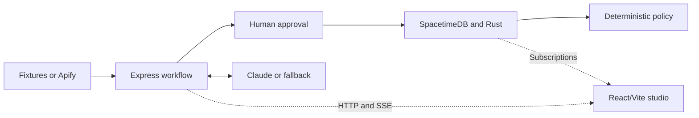

# CrowdTwin

**Test an event's vendor economics before committing inventory and capital.**

CrowdTwin is a spatial micro-market simulator for event vendors and underwriting
teams. It models individual attendees moving through a venue, deciding whether
to buy, waiting for service, and rejecting prices or queues. Those decisions
produce an auditable financial result, not a scripted success story.

Vendors can compare booth placement, staffing, and inventory interventions.
Underwriters can inspect low, base, and high turnout scenarios before making a
recommendation. CrowdTwin does **not** approve financing or transfer money.

## Current status

CrowdTwin supports a **hosted, shared demo** with configurable API and SpacetimeDB
URLs, an Express-served Vite build, live Claude/Apify, and persistent workflow
metadata. See [deployment instructions](docs/deployment.md). A public deployment
has not yet been provisioned; Docker image execution and a cloud database connection
still need verification on the chosen host. Live Droid intake is verified with the explicitly approved ToolSearch discovery
exception and an explicit Sonnet model.

| Area | Status |
| --- | --- |
| npm workspaces, shared Zod 3 contracts, validation, modeled fixtures | Implemented and tested |
| Deterministic Rust engine, local SpacetimeDB, generated TypeScript bindings | Implemented and tested |
| Express API, approval gate, paired variants, explanations, risk policy | Implemented and tested offline |
| Apify and Claude adapters | Real Apify captures and Claude map/persona calls verified on 2026-10-25 |
| Restricted Factory Droid coordination | Live intake verified on 2026-10-25; only CrowdTwin actions and approved ToolSearch discovery are allowed |
| Six-beat React/Vite studio | Implemented in `apps/web`; 21 vitest tests, typecheck, build, and the browser studio gate passed on 2026-10-24 |
| Recording and submission materials | Manual; measured shot list in [`docs/demo-script.md`](docs/demo-script.md), Mana links and architectural decisions documented below; no recording exists |

Local verification on **2026-10-24** passed: `npm run verify` (7 contract,
15 orchestrator, 21 web, and 8 Rust tests at `b68141d`), the database
integration gate (at `54a4b00`), the API gate for both the eight-hour modeled
demo and the real 32-hour capture, and the six-beat browser studio gate.
SpacetimeDB 1.12 is running locally and both TypeScript clients were
regenerated. The modeled demo figures below were re-measured unchanged; they do
not describe the real captured event.

Live Droid intake was verified on **2026-10-25** using Factory CLI 0.249.0 and
`DROID_MODEL=claude-sonnet-4-6`. Two issues were resolved: the runtime keeps
`ToolSearch` enabled (the owner explicitly approved metadata discovery), and the
default model returned success without invoking the required tools. The coordinator
now requests one validated step per turn, forces direct-only tool execution through
a pinned SDK/CLI compatibility adapter, checks actual workflow completion and
rechecks tool restrictions before every application action. Execute, file, network and other application tools remain disabled;
unknown permissions remain denied. The isolated Droid smoke test intentionally uses
deterministic map/persona handlers, separately from live Anthropic verification.
`COORDINATOR_MODE=deterministic` remains available as an explicit alternative.
The combined live intake subsequently passed with real Apify evidence (run
`8ARN6YTBfbj1YTA68`), `FACTORY_DROID` coordination and `CLAUDE` map/persona
sources, stopping at human approval. The current checks passed: build, 50 JavaScript
unit tests (7 contracts, 21 orchestrator, 22 web), database gate, API gate and
six-beat browser gate. No cloud deployment is claimed.

The studio runs at `http://127.0.0.1:5173` once the API is up (see
[Run locally](#run-locally)). The client is **React/Vite, not Next.js**.

## What the prototype does

1. **Collect evidence:** explicitly load a saved fixture (`Atlanta festival ·
   Apify snapshot`, the real 32-hour capture; `ATL festival · modeled demo`; or
   `Bay Area market · modeled demo`), or request live collection from a
   supported event URL.
2. **Draft assumptions:** prepare a normalized venue map, three attendee
   archetypes, and editable vendor economics. Offline drafts are labeled
   deterministic fallbacks.
3. **Require human approval:** stop at `AWAITING_APPROVAL`. Only the approval
   endpoint can initialize a newly approved world.
4. **Simulate demand:** Rust models arrivals, anchor-influenced movement,
   affordability, affinity, queues, service, abandonment, purchases, and stockouts.
5. **Compare interventions:** rerun a completed baseline with the same seed and
   horizon after relocation, an additional server, or an inventory-preparation cap.
6. **Inspect risk:** explain exact recorded decisions and evaluate 45 scenario
   runs using deterministic underwriting rules.

The studio in `apps/web` presents these six beats on one dark page: an intake
sidebar with the provenance badge (`CAPTURED · APIFY SNAPSHOT` for real saved evidence; `CAPTURED · MODELED DEMO` for synthetic examples), a
read-only evidence panel, a review form with a draggable booth on a 1,000 × 1,000
assumption-map canvas plus editable economics and per-cost confirmation boxes, a
Rust baseline view with Play/Pause/`+10x Step`/`Finish baseline` controls,
telemetry cards, a customer inspector that shows the exact recorded
`DecisionEvent`, a paired-intervention comparison table, and an Underwriter Desk
with the policy verdict, proposed cap, and three scenario summaries. A header
switcher toggles `1 · Vendor Sandbox` and `2 · Underwriter Desk`. The browser
reads simulation rows through a public SpacetimeDB subscription and never holds
the mutation token.

## Architecture

One Rust crate, one Express process, one React/Vite app, and a configured SpacetimeDB server.
There are no distributed jobs or multi-tenant authentication services.



- **Rust owns simulation facts and accounting.** Interactive steps and scenario
  batches reuse the same in-memory engine.
- **TypeScript owns intake, workflow gates, policy, and explanations.** Model
  output cannot change recorded decisions or policy verdicts.
- **SpacetimeDB exposes six public tables:** `run_state`, `anchor_node`, `booth`,
  `customer_agent`, `decision_event`, and `scenario_result`. Private authority
  and engine-snapshot tables protect mutations and preserve service progress.
- **One publisher identity can call reducers.** Browser clients are
  intended to consume subscriptions, not hold the mutation token.
- **Workflow state persists when `DATA_DIR` is configured.** Review drafts,
  approved runs and SSE history survive API restarts on a durable volume.
  Interrupted provider/initialization work is marked failed, never auto-retried.
  Without `DATA_DIR`, state remains process-local. Run one API replica.

### Repository layout

```text
packages/contracts/       Frozen shared schemas and companion validation
fixtures/                 Real ATL capture, modeled demo evidence, default world
crates/spacetime-module/   Rust engine, tables, reducers, and tests
apps/orchestrator/        Express API, adapters, workflow, and risk policy
apps/web/                 React/Vite studio, vitest tests, and generated bindings
scripts/                  Local environment setup and integration gates
docs/                     Measured 90-second demo recording script and the
                          loopback-only laptop demo runbook
```

Both apps' `src/module_bindings/` directories are generated from Rust. Do not
edit them by hand.

## Run locally

Run the following commands from the repository root. Initial installation needs
network access; the installed application can run against local fixtures without
contacting external providers. For a condensed cold-start checklist aimed at
running the recorded demo on one laptop, see
[`docs/demo-runbook.md`](docs/demo-runbook.md).

### 1. Install the pinned toolchain and dependencies

Requirements: **Node.js 22+**, npm, [Rustup](https://rustup.rs/), and the
[SpacetimeDB CLI](https://spacetimedb.com/install).

```bash
rustup toolchain install 1.90.0 --profile minimal --component rustfmt --target wasm32-unknown-unknown
# Use the pinned project-local runtime installed for this checkout.
export PATH="$PWD/.local/bin:$HOME/.cargo/bin:$HOME/.local/bin:$PATH"
./scripts/spacetime.sh --version

npm install
npm --workspace=packages/contracts run build
```

Keep the SpacetimeDB **module, CLI/server, and npm client at 1.12.0**. Do not mix
these bindings with current 2.x examples. Rust is pinned in `rust-toolchain.toml`.
The project wrapper uses its own CLI identity and preserves other installations.
For a fresh checkout, download the official 1.12 platform archive into
`.local/spacetime-1.12.0`; see [the updated specification](FACTORY_BUILD_PROMPT.md).

### 2. Start SpacetimeDB

In a dedicated terminal:

```bash
./scripts/spacetime.sh start --listen-addr 127.0.0.1:3000 --data-dir .spacetime --non-interactive
```

In another terminal, create a **local server-issued identity** and publish:

```bash
./scripts/spacetime.sh login --server-issued-login http://127.0.0.1:3000
./scripts/spacetime.sh publish --server http://127.0.0.1:3000 --project-path crates/spacetime-module crowdtwin -y
./scripts/spacetime.sh generate --lang typescript --project-path crates/spacetime-module --out-dir apps/web/src/module_bindings -y
./scripts/spacetime.sh generate --lang typescript --project-path crates/spacetime-module --out-dir apps/orchestrator/src/module_bindings -y
```

Use the same publishing identity for API mutations. Do not reset an existing
database or replace its identity to work around an authorization error.

### 3. Configure and start the API

```bash
node scripts/setup-local-env.mjs
npm --workspace=apps/orchestrator run dev
```

The setup script creates the ignored `apps/orchestrator/.env` with file mode
`0600`, the project-local CLI token (falling back to the global config if absent), and `OFFLINE_MODE=true`. It leaves provider keys
empty and **refuses to overwrite an existing file**. See
[`.env.example`](.env.example) for the available settings. Never expose
`SPACETIMEDB_TOKEN` to the browser or commit it.

In another terminal:

```bash
curl --fail http://localhost:4000/api/health
```

Healthy offline operation reports `ok: true`, `spacetime: "CONNECTED"`, and
`OFFLINE_DISABLED` for external providers.

### 4. Start the studio

With the API running, in another terminal:

```bash
npm --workspace=apps/web run dev
```

Open `http://127.0.0.1:5173`. Vite binds `127.0.0.1:5173` with `--strictPort`
and proxies `/api` to `http://127.0.0.1:4000`, so the API must already be up.
The API accepts exact browser origins configured through `ALLOWED_ORIGINS`;
local Vite/API origins are the development defaults. The browser uses the database
URL/name reported by the API, with optional `VITE_SPACETIMEDB_URI` and
`VITE_SPACETIMEDB_DB_NAME` build-time overrides. `VITE_API_BASE_URL` configures a
separately hosted API; leave it blank for same-origin hosting. Never put tokens
or provider keys in Vite variables. See [hosting](docs/deployment.md).

## API workflow

Start an explicit fixture intake:

```bash
curl --fail http://localhost:4000/api/jobs \
  -H 'Content-Type: application/json' \
  --data '{"mode":"CAPTURED","fixture":"atl"}'
```

`"atl"` is the real 32-hour Apify snapshot; `"demo"` is the modeled eight-hour
ATL event that reproduces the measured figures below; `"bay"` is the modeled
Bay Area fixture. The response contains a job ID. Read the job or its SSE stream
until it reaches `AWAITING_APPROVAL`, review the returned `world`, then submit
the complete reviewed world to the approval endpoint.

| Method and route | Purpose |
| --- | --- |
| `GET /api/health` | Local database and provider configuration status |
| `POST /api/jobs` | Start fixture or live intake |
| `GET /api/jobs/:id` | Read the draft, stage, provenance, and errors |
| `GET /api/jobs/:id/events` | Replayable SSE milestones; supports `Last-Event-ID` |
| `POST /api/jobs/:id/approve` | Submit `{ world, costs }`, initialize Rust, and run 45 scenarios |
| `GET /api/runs/:id` | Read the approved world and financial snapshot |
| `POST /api/runs/:id/step` | Advance `{ "steps": 10 }`; each tick is 30 simulated seconds |
| `POST /api/runs/:id/variants` | Apply `{ "relocate": true, "addServer": true, "capInventory": true }` |
| `POST /api/runs/:id/explain` | Explain the exact recorded `{ "eventId": "..." }` for this run |
| `GET /api/runs/:id/audit` | Return the three scenario summaries, policy verdict, and recommendation |

The `costs` object contains confirmation booleans for `unitCogsCents`,
`boothFeeCents`, `staffAndEquipmentCents`, and `organizerCutPct`. An unconfirmed
cost is **unknown**, not implicitly zero. Zero is valid when explicitly confirmed.
Evidence and provenance cannot be rewritten during assumption approval, and
configuration hashes are recomputed server-side.

Complete the baseline before requesting a variant. Mutations are serialized
per run. See [`scripts/api-gate.ts`](scripts/api-gate.ts) for an executable
end-to-end test, including approval-bypass rejection.

## Evidence and offline/live modes

- **The ATL snapshot is a real Apify capture.** `fixtures/captured-event.json`
  preserves run `yJgu1aGVtuTerBN8h`; its dataset reference is in
  `fixtures/captured-event.provenance.json`. `fixture: "atl"` loads it.
  The modeled examples remain available as `fixture: "demo"` and `fixture: "bay"`,
  with null actor IDs. See [fixture notes](fixtures/README.md).
- Events up to 72 hours are supported. This captured event spans 32 elapsed
  hours, including overnight time; closures are not modeled. Arrivals are spread
  over the first half of the span, booth fee and staff/equipment are flat per run
  (not prorated), and the map, archetypes, and booth economics come from the
  modeled default world unless edited during review. Prices and attendance
  missing from the actor remain unknown.
- To refresh the snapshot explicitly, run `node --import tsx scripts/capture-apify.ts`.
  It loads the local Apify key, allows a 120-second cold start, validates the result,
  and writes normalized evidence plus run/dataset metadata. An optional URL and
  existing run ID recover a completed run without another actor execution. The
  returned item must match the requested event (Eventbrite numeric ID and URL),
  and a capture of a different event is only replaced with `--replace`.
- The default world has **400 individual attendees and three archetypes**.
  It is not a weighted simulation of the modeled 40,000-person organizer claim.
- `OFFLINE_MODE=true` disables provider calls even if credentials exist in the
  environment. Claude drafts and narratives disclose deterministic fallback use.
- Live intake requires `OFFLINE_MODE=false` and `APIFY_API_TOKEN`. It accepts
  only HTTPS URLs on `eventbrite.com`, `www.eventbrite.com`, `lu.ma`, or
  `luma.com`, without credentials or custom ports. Allowlisting a host does not
  establish that the actor supports every event on that platform.
- The adapter uses `memo23/eventbrite-scraper`, with organizer enrichment and
  email harvesting disabled, a 120-second actor timeout and a 150-second collection deadline.
  Only Eventbrite collection is implemented; Luma returns an explicit unsupported-platform error.
- Missing keys, timeouts, and invalid evidence return `COLLECTION_TIMEOUT`
  with a specific cause and an explicit fixture action. Data is never silently
  replaced with a fixture.
- Successful live evidence is normalized and atomically cached in ignored
  `fixtures/last-live-capture.json` (or `DATA_DIR/last-live-capture.json` when configured). Raw actor datasets are not bundled.
- `ANTHROPIC_API_KEY` enables the Claude adapter when `OFFLINE_MODE=false`.
  `ANTHROPIC_MODEL` defaults to `claude-sonnet-4-6`; live failures return sanitized
  errors rather than silently producing deterministic output.
- `COORDINATOR_MODE=droid`, `FACTORY_API_KEY` and `OFFLINE_MODE=false` enable the restricted
  Droid coordinator (`apps/orchestrator/src/droidCoordinator.ts`). Offline mode or explicit
  `COORDINATOR_MODE=deterministic` runs deterministic coordination, labeled
  `DETERMINISTIC_FALLBACK`. Missing live credentials fail explicitly. Droid starts a session at
  `AutonomyLevel.Off`, lists tools, disables action tools outside the five
  `crowdtwin___*` MCP tools, permits the owner-approved ToolSearch discovery tool,
  re-lists to verify, and fails the job with `503 DROID_RESTRICTION_FAILED` if any
  other action tool is still enabled. The tools
  take no arguments and only call stage-gated workflow methods; the audit tool
  returns the unchanged deterministic policy result. The isolated live coordination gate passed; the manual check is `npx tsx scripts/droid-smoke.ts`, which
  loads `FACTORY_API_KEY` from the environment or orchestrator dotenv file and needs network access and never contacts
  Apify or Anthropic. Configuring a key does not make the integration verified.

## Accounting, determinism, and policy

All money is integer cents. Coordinates use a top-left-origin `0..1000` grid.

```text
inventory outlay = initial inventory units × unit COGS
consumed COGS    = units sold × unit COGS
organizer fee   = round(gross revenue × organizer cut / 100)
net profit      = gross revenue − consumed COGS − organizer fee − booth fee − staff/equipment
cash balance    = gross revenue − inventory outlay − organizer fee − booth fee − staff/equipment
```

Cash balance is net cash flow from a zero opening balance, not a bank account
balance. Unsold inventory remains an asset in the net-profit calculation; its
purchase already reduced cash. Spoilage, taxes, and inventory recovery proceeds
are not modeled.

The default $23,000 upfront capital comprises a $6,000 booth fee, $12,000 inventory
outlay, and $5,000 staff/equipment. The **$4,500 intervention caps inventory
preparation only**, not total capital. Adding a server adds $300 labor.

Traits use seeded SplitMix64 values keyed by local agent ID and purpose. Run-scoped
storage keys prevent collisions while preserving paired traits. Service runs on
a one-second clock inside 30-second ticks, with progress retained across reducer
calls. Changing step-call chunking does not change the result.

Scenario batches reuse the same engine: **LOW 50%, BASE 100%, HIGH 140% turnout**,
with 15 seeds each. Quantiles use nearest rank; P10 for 15 seeds is the second
lowest result. A profitable run means net profit is at least zero.

Policy checks run in this order:

1. `NEEDS_INPUT` if a required cost is unconfirmed.
2. `REJECT` if fewer than 50% of BASE runs break even, or organizer cut exceeds 25%.
3. `REFER` if LOW P10 profit loses more than 30% of total upfront capital.
4. Otherwise, `APPROVE`.

These are deterministic recommendations, **not funding authorizations or a
validated demand forecast**.

### Measured demo results

Modeled ATL demo fixture (`fixture: "demo"`, `fixtures/modeled-atl-event.json`),
seed 42 (fixed server-side), full 28,800-second (8h 00m) horizon,
default booth position and economics, all four costs confirmed. Re-measured on
2026-10-24 at commit `250b6d6` through both the HTTP API and the browser gate;
both produced the same figures. The intervention combines relocation, one
additional server, and the $4,500 inventory cap. Per-option figures, audit
tables, and a timed shot list are in [`docs/demo-script.md`](docs/demo-script.md).

| Rust result | Baseline | Intervention |
| --- | ---: | ---: |
| Units sold | 122 | 140 |
| Gross sales | $2,196.00 | $2,520.00 |
| Net profit | −$10,194.80 | −$10,376.00 |
| Cash balance | −$21,462.80 | −$14,036.00 |
| Inventory outlay | $12,000.00 | $4,500.00 |
| Queue-wait rejections | 51 | 9 |
| Price rejections | 172 | 172 |

The intervention reduces cash exposure and queue rejection, but added labor
outweighs its extra contribution margin. It does **not** turn this setup profitable.
With confirmed costs, policy is `REJECT` for both runs: 0/15 BASE runs break
even, LOW P10 profit is −$10,604.00 (baseline) and −$10,890.80 (intervention),
and the proposed inventory-preparation cap is $4,500.00. With any cost left
unconfirmed the verdict is `NEEDS_INPUT`. The original illustrative `−$24,600`
and `+$3,120` figures are not acceptance targets and the engine does not
reproduce them.

### Measured real-event run

The real 32-hour snapshot (`fixture: "atl"`, `fixtures/captured-event.json`)
was measured on 2026-10-24 at `54a4b00` through the API gate with seed 42, a
115,200-second horizon, all four costs confirmed, and the default booth.
Baseline: 138 units sold, $2,484.00 gross sales, −$10,089.20 net profit,
−$21,261.20 cash balance, $12,000.00 inventory outlay, 8 queue-wait and 172
price rejections. Scenarios: LOW 0/15 (P10 −$10,590.80), BASE 0/15 (P10
−$10,135.40), HIGH 0/15 (P10 −$9,779.00); verdict `REJECT`, proposed cap
$4,500.00. The combined intervention (relocation, one additional server, and
the cap): 141 units, $2,538.00 gross, −$10,369.40 net, −$14,023.40 cash, 0
queue-wait and 172 price rejections; verdict `REJECT`. `REJECT` follows from the
30% organizer cut, which exceeds the 25% rule regardless of horizon. These
figures are not the demo-script figures and the studio gate does not assert them.

## Verification

```bash
# Builds, TypeScript checks, contract/API unit tests, and Rust tests.
# No running database or provider credentials required.
npm run verify

# Requires the local database, published module, and publishing CLI identity.
SPACETIME_CLI="$PWD/scripts/spacetime.sh" npx tsx scripts/database-gate.ts

# Also requires the running API in offline mode.
npx tsx scripts/api-gate.ts

# Studio unit tests (jsdom + testing-library); no services required.
npm --workspace=apps/web test

# Browser acceptance gate. Requires the database, the API in offline mode, the
# Vite studio on port 5173, and the agent-browser CLI on PATH. Writes
# screenshots to the ignored test-results/ directory.
node scripts/studio-gate.mjs
```

Integration gates **write local test runs**. The database gate resets only its
`gate-baseline` and `gate-variant` runs; the API gate and the studio gate create
new jobs and runs and submit fixture approvals as test requests. Do not use them
against a shared or production database.

Previously passed checks cover accounting, rounding, replay, paired traits,
service progress, inventory limits, run isolation, scenario summaries, generated
subscriptions, approval enforcement, SSE replay, variants, and recorded-event
explanations. On 2026-10-24 at `b68141d`, `npm run verify`, the web tests,
typecheck, build, the API gate, and the studio gate passed; the gate drives all
six beats in a real browser, checks that a live failure never substitutes
fixture evidence, that unconfirmed costs yield `NEEDS_INPUT`, and that the
on-screen figures equal the measured table above. Apify captures and real Anthropic map/persona calls were verified on 2026-10-25.
The database, API and studio gates were rerun successfully after hosted configuration
changes. Droid intake passed with CLI 0.249.0 and the owner-approved ToolSearch discovery
exception after selecting `claude-sonnet-4-6` explicitly.

## Troubleshooting and limits

- **Database unavailable:** start the local server on `127.0.0.1:3000`, publish
  `crowdtwin`, and check the URI/database name in the API environment.
- **Mutation rejected:** the token must belong to the identity that first
  published the database. Keep it server-side; do not weaken reducer authorization.
- **Environment file already exists:** review it locally rather than overwriting
  it or pasting credentials into logs.
- **Old run requires approval after restart:** set `DATA_DIR` to a persistent volume before
  starting the API. Older in-memory jobs cannot be recovered retroactively.
- **Studio will not start on 5173:** the dev script uses `--strictPort`, so
  another process on `127.0.0.1:5173` makes Vite exit instead of choosing a
  different port. Free the port or update `ALLOWED_ORIGINS` and the Vite port together.
- **Studio shows "Local services are unavailable":** the Vite proxy could not
  reach `http://127.0.0.1:4000`. Start the API first, then refresh.
- **Simulation badge reads `DISCONNECTED`:** the browser's public SpacetimeDB
  subscription dropped. Use the `Reconnect` button; displayed rows may be stale
  until it reconnects.
- **Bindings fail to type-check:** confirm all SpacetimeDB components are 1.12.0
  and regenerate both clients. The current Rust `*Data` types and `*Row` aliases
  avoid a 1.12 generator naming collision. Generated imports require the apps'
  bundler-style TypeScript resolution.
- **`wasm-opt` is missing:** publishing still works; this is an optional
  optimization warning, not a failed build.
- **Capacity:** local limits are 100 jobs per API process and 100 stored runs,
  plus 10 SSE subscribers per job. Restarting the API does not clear database runs.
- **Security:** hosted mode requires explicit allowed origins and a shared demo
  password. Use an HTTPS ingress; this is not a multi-tenant application.
  Dependency audit reports advisories affecting the required Zod 3 stack and
  the Droid SDK's UUID dependency. Inputs are bounded before Zod validation,
  but these advisories are not claimed to be resolved.

## How Mana Changed What We Built

The architecture and build plan were brainstormed and refined in Mana, and the
prototype was built from there. Both Mana pages below are public; the brainstorm
board contains a "Demo & Build Plan" page. Mana reviewed our earlier pipeline
assumptions and caught the following problems before they were built. Each item
states what shipped on `main` as a result; where the shipped code differs from
the original pivot, the difference is noted.

- Brainstorming and refining the workflow approach:
  <https://www.mana.space/home/cwaWYKmyeZTs7SX0NlXLP8V93Ec2/brainstorm>
- Prototype building:
  <https://www.mana.space/home/cwaWYKmyeZTs7SX0NlXLP8V93Ec2/apps/crowdtwin>

### What Mana caught

1. **Apify actor replacement.** Earlier assumption: use
   `matyascimbulka/luma-event-scraper` for Luma and `apify/google-maps-scraper`
   for competitors. Mana's finding: the Luma actor only accepts city/category
   discovery slugs, not a direct event URL. What shipped: a single
   `memo23/eventbrite-scraper` call in `apps/orchestrator/src/apifyAdapter.ts`
   that takes the event URL directly for eventbrite.com and lu.ma/luma.com,
   with `maxItems: 1`, `enrichOrganizer: false`, and
   `harvestOrganizerEmails: false`. No competitor or Google Places crawler was
   built: the planned `compass/crawler-google-places` call does not exist, and
   `nearbyCompetitorPriceBands` holds only what the event item or fixture
   supplies.
2. **Real `@factory/droid-sdk` wiring.** Earlier assumption: treat Droid as a
   generic LLM wrapper in one loop. Mana's finding: the real
   `@factory/droid-sdk/node` surface is `createSdkMcpServer()` with Zod 3 tool
   helpers, one active stream per session, and only `disabledToolIds` (no
   allowlist). What shipped: `apps/orchestrator/src/droidCoordinator.ts`
   creates the session at `AutonomyLevel.Off` with `disableBuiltinSkills: true`,
   lists tools, passes every tool outside the five `crowdtwin___*` tools to
   `disabledToolIds`, re-lists to verify, and uses a deny-by-default
   `permissionHandler` that proceeds only for those five MCP tools. The
   restriction logic is unit-tested offline; live intake and audit coordination
   have also been exercised with explicit model and runtime settings. The async design (end the turn, poll Apify from Node, resume the
   session) was not implemented: `collect_event` calls the workflow
   synchronously under the adapter's 25-second deadline.
3. **The "10-second live scrape" myth.** Earlier assumption: a live scrape
   finishes in under 10 seconds, or a cached fallback is swapped in silently.
   Mana's finding: Apify cold starts carry no 10-second guarantee, and a silent
   swap violates the Hyphenate rule (what's real, what's simulated, and how they
   know). What shipped: `ProvenanceModeSchema` (`LIVE`, `CAPTURED`, `MANUAL`)
   in `packages/contracts/src/index.ts`, the `AWAITING_APPROVAL` human gate in
   the workflow, and a `COLLECTION_TIMEOUT` error that offers explicit fixture
   loading instead of substituting it. Intake accepts `CAPTURED` fixtures or
   `LIVE` URLs; `MANUAL` exists only in the schema. The `demo` and `bay`
   fixtures are modeled demo data with `actorRunId: null`, so they carry no
   Apify run ID; `fixtures/captured-event.json` (`atl`) is a real capture from
   run `yJgu1aGVtuTerBN8h`, with the dataset reference in
   `fixtures/captured-event.provenance.json`. A successful live capture is
   written to the ignored `fixtures/last-live-capture.json` with its actor run
   ID and `capturedAtIso`,
   and `LIVE` evidence fails validation without a real run ID.
4. **Replacing a four-number payload with `WorldSpec` and `DecisionEvent`.**
   Earlier assumption: pass `expected_turnout`, `ticket_price`,
   `competitor_count`, and `duration_hours`. Mana's finding: four numbers cannot
   model spatial paths, queue balking, capacity, stockouts, or COGS, and Claude
   would hallucinate "why didn't you buy" without the customer's exact state.
   What shipped: the frozen `WorldSpecSchema` (evidence, anchors, booth,
   personas, `configHash`) in `packages/contracts/src/index.ts`, with evidence
   immutable during approval and the hash recomputed server-side, and the
   public Rust `decision_event` table in `crates/spacetime-module/src/tables.rs`
   whose rows record `agentWalletCents`, `agentHunger`, `agentPatienceSec`,
   `observedPriceCents`, `estimatedWaitSec`, and `remainingStock` at decision
   time. The explain endpoint only narrates a recorded row.
5. **Double-counted inventory math and RNG drift.** Earlier assumption:
   subtract the upfront inventory outlay and per-item COGS in one metric, and
   use one global RNG. Mana's finding: that double-counts inventory, and a
   global RNG makes any change shift every later draw, invalidating the
   before/after comparison. What shipped: `Accounts::update` in
   `crates/spacetime-module/src/engine.rs` keeps `net_profit_cents` (revenue
   minus consumed COGS, organizer fee, booth fee, staff/equipment) separate
   from `cash_balance_cents` (revenue minus organizer fee, full inventory
   outlay, booth fee, staff/equipment), and `trait_random(seed, agent, purpose)`
   derives each agent's traits from SplitMix64 keyed by run seed, agent ID, and
   purpose tag, so paired variants keep the same attendees.
6. **Separating RSVPs from turnout and food budgets.** Earlier assumption:
   treat the scraped RSVP count as verified attendance and the ticket price as
   the food budget. Mana's finding: an RSVP is not a check-in, a missing count
   is unknown rather than zero, and a $150 ticket is admission, not spending
   money. What shipped: no `EvidenceRecord` wrapper or source-kind enum exists.
   Instead `EventEvidenceSchema` keeps `platformRsvpCount`,
   `organizerClaimedAttendance`, and `ticketPriceCents` as separate nullable
   fields, validation preserves `null`, the evidence panel renders `Unknown`,
   the attendee count is the reviewed `totalSimulatedAttendees`, and wallets
   come from persona wallet ranges, not the ticket price.
7. **Strict URL hostname parsing instead of `url.includes()`.** Earlier
   assumption: `url.includes("eventbrite.com")`. Mana's finding: that lets
   `https://attacker.com/?q=eventbrite.com` trigger paid actor runs. What
   shipped: `validateEventUrl` in `apps/orchestrator/src/apifyAdapter.ts`
   parses with `new URL()`, requires `https:`, and matches `url.hostname`
   exactly against `eventbrite.com`, `www.eventbrite.com`, `lu.ma`, and
   `luma.com`, rejecting credentials and custom ports.

The 90-second submission recording remains a manual item; a measured shot list
with the exact on-screen values is in [`docs/demo-script.md`](docs/demo-script.md).

## Contributing

Read [`AGENTS.md`](AGENTS.md) for build commands, generated-code rules, safety
boundaries, and verification expectations. Keep changes small and tested, preserve
honest provenance, and do not present planned features as delivered.
