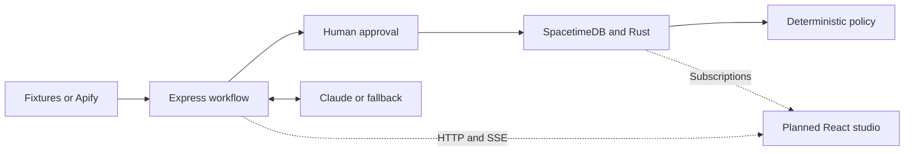

# CrowdTwin

**Test an event's vendor economics before committing inventory and capital.**

CrowdTwin is a spatial micro-market simulator for event vendors and underwriting
teams. It models individual attendees moving through a venue, deciding whether
to buy, waiting for service, and rejecting prices or queues. Those decisions
produce an auditable financial result, not a scripted success story.

Vendors can compare booth placement, staffing, and inventory interventions.
Underwriters can inspect low, base, and high turnout scenarios before making a
recommendation. CrowdTwin does **not** approve financing or transfer money.

## Current status

This is a **local backend prototype**, not yet a finished web application.

| Area | Status |
| --- | --- |
| npm workspaces, shared Zod 3 contracts, validation, modeled fixtures | Implemented and tested |
| Deterministic Rust engine, local SpacetimeDB, generated TypeScript bindings | Implemented and tested |
| Express API, approval gate, paired variants, explanations, risk policy | Implemented and tested offline |
| Apify and Claude adapters | Implemented; live provider calls unverified because keys were absent |
| Restricted Factory Droid coordination | Blocked during integration; not delivered on `main` |
| Six-beat React/Vite studio | Planned; `apps/web` currently contains a scaffold and generated bindings |
| Recording and submission materials | Pending |

The latest implementation checks ran on **2026-10-24**. Phases 1–2 passed their
gates, and the offline Phase 3 API flow passed. The separate Droid smoke check
stopped **before sending a prompt**: the installed CLI still reported
`ToolSearch` enabled after it was included in `disabledToolIds`. The integration
fails closed rather than allowing tools outside the approved application set.

There is no web development server or usable studio at `localhost:5173` yet.
The intended client is **React/Vite, not Next.js**.

## What the prototype does

1. **Collect evidence:** explicitly load the ATL or Bay Area fixture, or request
   live collection from a supported event URL.
2. **Draft assumptions:** prepare a normalized venue map, three attendee
   archetypes, and editable vendor economics. Offline drafts are labeled
   deterministic fallbacks.
3. **Require human approval:** stop at `AWAITING_APPROVAL`. Only the approval
   endpoint can initialize a newly approved world.
4. **Simulate demand:** Rust models arrivals, anchor-influenced movement,
   affordability, affinity, queues, service, abandonment, purchases, and stockouts.
5. **Compare interventions:** rerun a completed baseline with the same seed and
   horizon after relocation, an additional server, or an inventory-preparation cap.
6. **Inspect risk:** explain exact recorded decisions and evaluate 45 scenario
   runs using deterministic underwriting rules.

The planned studio will bring these steps into a dark, single-screen interface
with a draggable booth, a 1000×1000 canvas, agent inspection, live telemetry, and
a vendor/underwriter view switcher.

## Architecture

One Rust crate, one Express process, one planned React app, and local SpacetimeDB.
There are no distributed jobs or multi-tenant authentication services.



- **Rust owns simulation facts and accounting.** Interactive steps and scenario
  batches reuse the same in-memory engine.
- **TypeScript owns intake, workflow gates, policy, and explanations.** Model
  output cannot change recorded decisions or policy verdicts.
- **SpacetimeDB exposes six public tables:** `run_state`, `anchor_node`, `booth`,
  `customer_agent`, `decision_event`, and `scenario_result`. Private authority
  and engine-snapshot tables protect mutations and preserve service progress.
- **One local publisher identity can call reducers.** Browser clients are
  intended to consume subscriptions, not hold the mutation token.
- **Workflow state is process-local.** API restarts discard jobs, approval
  metadata, and SSE history. Database rows persist, but old runs cannot be
  mutated through the restarted API. Start a new intake and approval flow.

### Repository layout

```text
packages/contracts/       Frozen shared schemas and companion validation
fixtures/                 Modeled ATL/Bay Area evidence and default world
crates/spacetime-module/   Rust engine, tables, reducers, and tests
apps/orchestrator/        Express API, adapters, workflow, and risk policy
apps/web/                 Planned React/Vite client scaffold
scripts/                  Local environment setup and integration gates
```

Both apps' `src/module_bindings/` directories are generated from Rust. Do not
edit them by hand.

## Run locally

Run the following commands from the repository root. Initial installation needs
network access; the installed application can run against local fixtures without
contacting external providers.

### 1. Install the pinned toolchain and dependencies

Requirements: **Node.js 22+**, npm, [Rustup](https://rustup.rs/), and the
[SpacetimeDB CLI](https://spacetimedb.com/install).

```bash
rustup toolchain install 1.90.0 --profile minimal --component rustfmt --target wasm32-unknown-unknown
spacetime version install 1.12.0
spacetime version use 1.12.0
spacetime --version

npm install
npm --workspace=packages/contracts run build
```

Keep the SpacetimeDB **module, CLI/server, and npm client at 1.12.0**. Do not mix
these bindings with current 2.x examples. Rust is pinned in `rust-toolchain.toml`.
Ensure Cargo and SpacetimeDB are on your `PATH`.

### 2. Start SpacetimeDB

In a dedicated terminal:

```bash
spacetime start --listen-addr 127.0.0.1:3000 --data-dir .spacetime --non-interactive
```

In another terminal, create a **local server-issued identity** and publish:

```bash
spacetime login --server-issued-login http://127.0.0.1:3000
spacetime publish --server http://127.0.0.1:3000 --project-path crates/spacetime-module crowdtwin -y
spacetime generate --lang typescript --project-path crates/spacetime-module --out-dir apps/web/src/module_bindings -y
spacetime generate --lang typescript --project-path crates/spacetime-module --out-dir apps/orchestrator/src/module_bindings -y
```

Use the same publishing identity for API mutations. Do not reset an existing
database or replace its identity to work around an authorization error.

### 3. Configure and start the API

```bash
node scripts/setup-local-env.mjs
npm --workspace=apps/orchestrator run dev
```

The setup script creates the ignored `apps/orchestrator/.env` with file mode
`0600`, the local CLI token, and `OFFLINE_MODE=true`. It leaves provider keys
empty and **refuses to overwrite an existing file**. See
[`.env.example`](.env.example) for the available settings. Never expose
`SPACETIMEDB_TOKEN` to the browser or commit it.

In another terminal:

```bash
curl --fail http://localhost:4000/api/health
```

Healthy offline operation reports `ok: true`, `spacetime: "CONNECTED"`, and
`OFFLINE_DISABLED` for external providers.

## API workflow

Start an explicit fixture intake:

```bash
curl --fail http://localhost:4000/api/jobs \
  -H 'Content-Type: application/json' \
  --data '{"mode":"CAPTURED","fixture":"atl"}'
```

Use `"bay"` for the Bay Area fixture. The response contains a job ID. Read the
job or its SSE stream until it reaches `AWAITING_APPROVAL`, review the returned
`world`, then submit the complete reviewed world to the approval endpoint.

| Method and route | Purpose |
| --- | --- |
| `GET /api/health` | Local database and provider configuration status |
| `POST /api/jobs` | Start fixture or live intake |
| `GET /api/jobs/:id` | Read the draft, stage, provenance, and errors |
| `GET /api/jobs/:id/events` | Replayable SSE milestones; supports `Last-Event-ID` |
| `POST /api/jobs/:id/approve` | Submit `{ world, costs }`, initialize Rust, and run 45 scenarios |
| `GET /api/runs/:id` | Read the approved world and financial snapshot |
| `POST /api/runs/:id/step` | Advance `{ "steps": 10 }`; each tick is 30 simulated seconds |
| `POST /api/runs/:id/variants` | Apply `{ "relocate": true, "addServer": true, "capInventory": true }` |
| `POST /api/runs/:id/explain` | Explain the exact recorded `{ "eventId": "..." }` for this run |
| `GET /api/runs/:id/audit` | Return the three scenario summaries, policy verdict, and recommendation |

The `costs` object contains confirmation booleans for `unitCogsCents`,
`boothFeeCents`, `staffAndEquipmentCents`, and `organizerCutPct`. An unconfirmed
cost is **unknown**, not implicitly zero. Zero is valid when explicitly confirmed.
Evidence and provenance cannot be rewritten during assumption approval, and
configuration hashes are recomputed server-side.

Complete the baseline before requesting a variant. Mutations are serialized
per run. See [`scripts/api-gate.ts`](scripts/api-gate.ts) for an executable
end-to-end test, including approval-bypass rejection.

## Evidence and offline/live modes

- **Bundled fixtures are modeled demo data, not verified live captures.**
  They use `CAPTURED` mode with `actorRunId: null`. Their dates, attendance,
  prices, and locations are illustrative. See [fixture notes](fixtures/README.md).
- The default world has **400 individual attendees and three archetypes**.
  It is not a weighted simulation of the modeled 40,000-person organizer claim.
- `OFFLINE_MODE=true` disables provider calls even if credentials exist in the
  environment. Claude drafts and narratives disclose deterministic fallback use.
- Live intake requires `OFFLINE_MODE=false` and `APIFY_API_TOKEN`. It accepts
  only HTTPS URLs on `eventbrite.com`, `www.eventbrite.com`, `lu.ma`, or
  `luma.com`, without credentials or custom ports. Allowlisting a host does not
  establish that the actor supports every event on that platform.
- The adapter uses `memo23/eventbrite-scraper`, with organizer enrichment and
  email harvesting disabled, and a 25-second collection deadline.
- Missing keys, timeouts, and invalid evidence return `COLLECTION_TIMEOUT`
  with a specific cause and an explicit fixture action. Data is never silently
  replaced with a fixture.
- Successful live evidence is normalized and atomically cached in ignored
  `fixtures/last-live-capture.json`. Raw actor datasets are not bundled.
- `ANTHROPIC_API_KEY` enables the Claude adapter. Factory coordination remains
  blocked as described above; configuring a key does not make that integration
  verified or complete.

## Accounting, determinism, and policy

All money is integer cents. Coordinates use a top-left-origin `0..1000` grid.

```text
inventory outlay = initial inventory units × unit COGS
consumed COGS    = units sold × unit COGS
organizer fee   = round(gross revenue × organizer cut / 100)
net profit      = gross revenue − consumed COGS − organizer fee − booth fee − staff/equipment
cash balance    = gross revenue − inventory outlay − organizer fee − booth fee − staff/equipment
```

Cash balance is net cash flow from a zero opening balance, not a bank account
balance. Unsold inventory remains an asset in the net-profit calculation; its
purchase already reduced cash. Spoilage, taxes, and inventory recovery proceeds
are not modeled.

The default $23,000 upfront capital comprises a $6,000 booth fee, $12,000 inventory
outlay, and $5,000 staff/equipment. The **$4,500 intervention caps inventory
preparation only**, not total capital. Adding a server adds $300 labor.

Traits use seeded SplitMix64 values keyed by local agent ID and purpose. Run-scoped
storage keys prevent collisions while preserving paired traits. Service runs on
a one-second clock inside 30-second ticks, with progress retained across reducer
calls. Changing step-call chunking does not change the result.

Scenario batches reuse the same engine: **LOW 50%, BASE 100%, HIGH 140% turnout**,
with 15 seeds each. Quantiles use nearest rank; P10 for 15 seeds is the second
lowest result. A profitable run means net profit is at least zero.

Policy checks run in this order:

1. `NEEDS_INPUT` if a required cost is unconfirmed.
2. `REJECT` if fewer than 50% of BASE runs break even, or organizer cut exceeds 25%.
3. `REFER` if LOW P10 profit loses more than 30% of total upfront capital.
4. Otherwise, `APPROVE`.

These are deterministic recommendations, **not funding authorizations or a
validated demand forecast**.

### Measured demo results

ATL fixture, seed 42, full eight-hour horizon. The intervention combines relocation,
one additional server, and the $4,500 inventory cap.

| Rust result | Baseline | Intervention |
| --- | ---: | ---: |
| Units sold | 122 | 140 |
| Gross sales | $2,196.00 | $2,520.00 |
| Net profit | −$10,194.80 | −$10,376.00 |
| Cash balance | −$21,462.80 | −$14,036.00 |
| Inventory outlay | $12,000.00 | $4,500.00 |
| Queue-wait rejections | 51 | 9 |
| Price rejections | 172 | 172 |

The intervention reduces cash exposure and queue rejection, but added labor
outweighs its extra contribution margin. It does **not** turn this setup profitable.
With confirmed costs, policy remains `REJECT`. The original illustrative
`−$24,600` and `+$3,120` figures are not acceptance targets.

## Verification

```bash
# Builds, TypeScript checks, contract/API unit tests, and Rust tests.
# No running database or provider credentials required.
npm run verify

# Requires the local database, published module, and publishing CLI identity.
SPACETIME_CLI="$(command -v spacetime)" npx tsx scripts/database-gate.ts

# Also requires the running API in offline mode.
npx tsx scripts/api-gate.ts
```

Integration gates **write local test runs**. The database gate resets only its
`gate-baseline` and `gate-variant` runs; the API gate creates new jobs and runs and
submits fixture approvals as test requests. Do not use them against a shared or
production database.

Previously passed checks cover accounting, rounding, replay, paired traits,
service progress, inventory limits, run isolation, scenario summaries, generated
subscriptions, approval enforcement, SSE replay, variants, and recorded-event
explanations. Real Apify/Anthropic calls and browser acceptance tests remain
unverified. The separate credentialed Droid restriction check failed closed.

## Troubleshooting and limits

- **Database unavailable:** start the local server on `127.0.0.1:3000`, publish
  `crowdtwin`, and check the URI/database name in the API environment.
- **Mutation rejected:** the token must belong to the identity that first
  published the database. Keep it server-side; do not weaken reducer authorization.
- **Environment file already exists:** review it locally rather than overwriting
  it or pasting credentials into logs.
- **Old run requires approval after restart:** approval metadata is intentionally
  not persisted. Create a new job.
- **Bindings fail to type-check:** confirm all SpacetimeDB components are 1.12.0
  and regenerate both clients. The current Rust `*Data` types and `*Row` aliases
  avoid a 1.12 generator naming collision. Generated imports require the apps'
  bundler-style TypeScript resolution.
- **`wasm-opt` is missing:** publishing still works; this is an optional
  optimization warning, not a failed build.
- **Capacity:** local limits are 100 jobs per API process and 100 stored runs,
  plus 10 SSE subscribers per job. Restarting the API does not clear database runs.
- **Security:** this prototype is loopback-only and not production-hardened.
  Dependency audit reports advisories affecting the required Zod 3 stack and
  the Droid SDK's UUID dependency. Inputs are bounded before Zod validation,
  but these advisories are not claimed to be resolved.

## How Mana Changed What We Built

**Manual item: add your actual public Mana page/chat link and describe the
specific decisions it influenced.**

No public Mana link or Mana usage has been verified. This section is a placeholder,
not a claim of usage or submission eligibility. The actual 90-second submission
recording also remains a manual item.

## Contributing

Read [`AGENTS.md`](AGENTS.md) for build commands, generated-code rules, safety
boundaries, and verification expectations. Keep changes small and tested, preserve
honest provenance, and do not present planned features as delivered.
